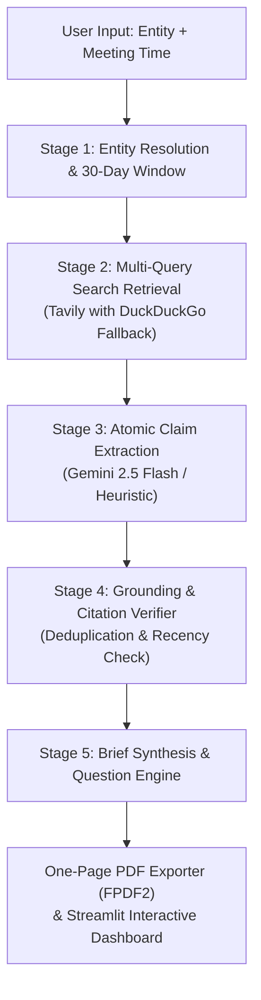

# 📋 Pre-Meeting Briefing Agent

> **AI Hackathon Project:** Given a company or person and a meeting time, produce an executive **one-page brief** covering the last 30 days of news, hires, launches, and open questions, with **every claim sourced**.

---

## 💡 The Core Problem

Executives, sales leaders, and investors spend 20–30 minutes before high-stakes meetings manually trawling through search engines, LinkedIn, and press releases. Current LLM summarizers suffer from **hallucinations**, cite stale multi-year-old articles, or invent fake citations.

The **Pre-Meeting Briefing Agent** solves this with an audit-grounded intelligence pipeline:
- **Strict 30-Day Time Horizon:** Automatically calculates the reference window relative to the meeting date (`Meeting Time - 30 Days`).
- **100% Sourced Claims:** Every single factual bullet point is attributed to a verified, deduplicated citation tag (`[1]`, `[2]`), linked to a real URL and published date.
- **Strategic Open Questions:** Synthesizes recent launches and leadership changes into tactical conversation starters.
- **Executive One-Page PDF:** Generates a single-page PDF memo with clickable links.

---

## 📐 Blueprint: The 6 Core Sections

| Section | Focus | Grounding Rule |
|---|---|---|
| **1. Snapshot** | 2 concise lines on identity, business model, scale, or role | Sourced `[X]` |
| **2. News (30d)** | Top 3–5 material developments with date stamps | Strictly scoped to 30-day window |
| **3. Hires & Departures** | Executive leadership moves, board shifts, appointments | Sourced `[X]` |
| **4. Launches & Funding** | New products, capital rounds, valuations, partnerships | Sourced `[X]` |
| **5. Open Questions** | 3–4 high-impact strategic questions for the meeting | Synthesized from verified events |
| **6. Sources** | Numbered list: Domain, Title, Published Date, and Link | Clickable references |

---

## 🏗️ Architecture & Pipeline Flow



---

## 🚀 Quickstart Guide

### 1. Prerequisites
- Python 3.10+ (Tested on Python 3.13)

### 2. Installation
Clone the repository and install the dependencies:
```bash
git clone <repo-url>
cd "Pre-meeting briefing agent"
pip install -r requirements.txt
```

### 3. Configure API Keys (Optional but Recommended)
Copy `.env.example` to `.env`:
```bash
cp .env.example .env
```
Fill in your keys:
```env
# Gemini API Key (for LLM extraction & questions)
GEMINI_API_KEY=your_gemini_api_key_here

# Tavily API Key (Primary search engine; falls back to DuckDuckGo if blank)
TAVILY_API_KEY=your_tavily_api_key_here

# Model selection
GEMINI_MODEL=gemini-2.5-flash
```
*(Note: You can also enter or swap API keys directly inside the Streamlit UI sidebar during live demos!)*

### 4. Run the Streamlit Web Application
```bash
streamlit run app.py
```
Open your browser at `http://localhost:8501`.

### 5. CLI Test Script
To test the pipeline directly in your terminal:
```bash
python test_pipeline.py
```
This generates `test_output_brief.pdf` in the root folder.

---

## 🛠️ Project Directory Structure

```
Pre-meeting briefing agent/
├── app.py                     # Streamlit interactive UI with demo presets
├── test_pipeline.py           # CLI runner & verification tester
├── requirements.txt           # Python dependencies
├── .env.example               # Environment template
├── README.md                  # Documentation & architecture
└── src/
    ├── __init__.py
    ├── models.py              # Pydantic models (Entity, Claim, Source, BriefData)
    ├── entity_resolver.py     # Entity classifier & 30-day window calculator
    ├── search_retriever.py    # Tavily API + resilient DuckDuckGo search
    ├── claim_extractor.py     # Gemini atomic claim extractor with fallback
    ├── verifier.py            # Citation grounding, deduplication & question generator
    ├── brief_generator.py     # 6-section blueprint synthesis & markdown builder
    └── pdf_exporter.py        # Executive one-page PDF generator (fpdf2)
```

---

## 🏆 Key Hackathon Highlights

1. **Zero-Config Fallback:** Works even without paid API keys via built-in DuckDuckGo search and rule-based extraction fallback.
2. **True Single-Page PDF Layout:** Specially tuned margins, typography, and line-height budgeting to guarantee a single-page output.
3. **Grounding Audit Tab:** A dedicated transparency inspector in Streamlit showing judges the exact raw search results and grounding checks.
4. **Interactive Demo Presets:** 1-click buttons in the sidebar for popular entities ("Stripe", "Anthropic", "Satya Nadella", "Jensen Huang") for seamless live judging presentations.
