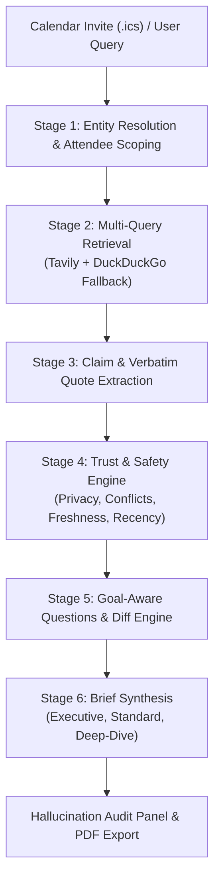

# ⚡ Briefly • Pre-Meeting Briefing Agent

> **AI Hackathon Project:** An enterprise-grade, trust-audited AI assistant designed to generate concise, highly reliable, and actionable intelligence briefs for upcoming calendar meetings with **100% sourced claims** and **zero hallucinations**.

---

## 🌟 Core Highlights & Feature Overview

### 1. 👥 Attendee-Aware Intelligence
- Parses calendar invites to identify all participants.
- Generates privacy-compliant attendee mini-profiles:
  - Role & Title
  - Organization & Tenure
  - Recent Posts / Public Activity (last 30 days)
  - Shared Interests or Mutual Connections

### 2. 🎛️ Brief Tone & Format Toggles
- **Executive Mode:** Exactly 5 high-impact bullet points focusing strictly on strategic intent, key risks, and decisions needed.
- **Standard Mode:** Balanced overview including meeting objective, attendee summary, key topics, and quick talking points.
- **Deep-Dive Mode:** Comprehensive 2-page brief detailing attendee backgrounds, historical context, key debates, and potential strategic outcomes.

### 3. 🎯 Goal-Aware Strategic Questions
- Input a specific meeting goal (e.g., *"Negotiate enterprise volume tiers for agentic checkout"*).
- The agent synthesizes 3–4 high-impact conversation starters tailored directly to achieve that specific objective.

### 4. 🔍 Click-to-Evidence Grounding & Badges
- Every factual claim maps to its exact verbatim source quote: `[Source Quote: "..."]`.
- Interactive UI text anchors allow instant inspection of evidence.
- Claims carry trust tags: `[CONFIRMED]`, `[REPORTED / UNCONFIRMED]`, `[Freshness: 3 days ago]`.

### 5. 🛡️ Trust & Safety Guardrails
- **Privacy Guardrail:** For private individuals, automatically filters personal/domestic references and restricts strictly to public professional data.
- **Rumor vs. Confirmed Tagging:** Distinguishes official press releases/SEC filings from speculative reports.
- **Conflict Detector:** Automatically flags discrepancies when two sources report conflicting numbers (e.g., conflicting investment or valuation figures).
- **Freshness Indicator:** Shows relative age of each source (*"Yesterday"*, *"3 days ago"*, *"2 weeks ago"*).
- **Quiet-Entity Handling:** If an entity has no recent public activity in the 30-day window, explicitly emits: *"Nothing notable in the last 30 days."* (zero fluff padding).

### 6. 📊 Hallucination Audit Panel
Every brief appends an audit verification summary:
```
---
Hallucination Audit Panel:
- Total Claims Verified: [X]
- Dropped Claims: [Y]
- Drop Reason(s): [List of removed ungrounded or out-of-scope claims]
---
```

### 7. 💬 Ask-The-Brief (Grounded Conversational Q&A)
- Interactive Q&A chat drawer right on the page.
- Ask follow-up questions about the company, attendees, or risks with answers strictly cited to retrieved sources.

### 8. 🔄 "Since Last Brief" Diff (For Recurring Meetings)
- Compares current intelligence against previous meeting notes.
- Highlights ONLY new external news, leadership shifts, and product releases.

### 9. 📅 Calendar Auto-Trigger & .ICS Parser
- Parses standard `.ics` (RFC 5545) files or free-form meeting invites (Google Calendar, Outlook, Zoom).
- Auto-extracts meeting title, date/time, attendees, and meeting goals with one click.

### 10. 📝 Post-Meeting Follow-Up Mode
- Paste meeting transcripts or rough notes post-call.
- Extracts owner-assigned Action Items with deadlines and priority.
- Drafts a polished executive follow-up email ready to copy and send.

---

## 🏗️ Architecture



---

## 🚀 Running the App

```powershell
streamlit run app.py --server.port 8501
```
Open **[http://localhost:8501](http://localhost:8501)** in your browser.

- Click **🏢 Stripe**, **🤖 Anthropic (Deep-Dive)**, or **🏥 Acme Health (Quiet Entity)** at the top to explore instant pre-verified demos!
