# ⚡ Briefly • Pre-Meeting Executive Briefing Agent

<p align="center">
  
  
  
  
  
  
</p>

> **AI Hackathon Problem Statement:**  
> *Given a company or person and a meeting time, produce a one-page brief covering the last 30 days of news, hires, launches, and open questions, with every claim sourced.*

**Briefly** is an enterprise-grade AI intelligence assistant that converts calendar invites or company queries into concise, 100% sourced, and hallucination-audited pre-meeting briefs. Powered by **Google Gemini 2.5 Flash**, dual search retrievers (Tavily + DuckDuckGo fallback), and a strict Trust & Safety audit engine, it guarantees that every single insight is backed by a verbatim quote anchor.

---

## 📸 Executive Dashboard & Theme

Designed with a high-visibility **Warm Peach & Radiant Light Orange** aesthetic, featuring:
- **Extra-large command consoles** for entity queries and meeting goals.
- **Segmented frosted oval pill tabs** (`border-radius: 9999px`) that elevate on hover with radiant active lighting.
- **Instant 1-click demo chips** for immediate testing with zero setup required.
- **Interactive Click-to-Evidence anchors** linking claims to exact quoted excerpts.

---

## 🌟 Core Highlights & Feature Specifications

### 1. 👥 Attendee-Aware Intelligence
- Parses calendar invites (`.ics` RFC 5545 format or free-text) to identify participants.
- Constructs privacy-compliant attendee mini-profiles covering:
  - **Role & Title**
  - **Organization & Tenure**
  - **Recent Activity / Public Posts** (within 30 days)
  - **Shared Interests & Mutual Strategic Context**

### 2. 🎛️ Brief Tone & Format Toggles
Adaptable briefing depth depending on the stakes of the meeting:
- **Executive Mode:** Exactly 5 high-impact bullet points focusing strictly on strategic intent, market status, key risks, and decisions needed.
- **Standard Mode:** Balanced overview featuring identity snapshot, top 30-day news items, hires/departures, product/funding launches, and goal-aware talking points.
- **Deep-Dive Mode:** Comprehensive multi-section dossier detailing attendee backgrounds, historical context, key debates, and potential strategic outcomes.

### 3. 🎯 Goal-Aware Strategic Questions
- Input a specific meeting objective (e.g. *"Negotiate enterprise volume tiers for agentic checkout protocol"*).
- The agent analyzes the last 30 days of verified moves and synthesizes 3 to 4 authoritative questions connecting recent developments directly to your goal.

### 4. 🔍 Click-to-Evidence Grounding & Verification Badges
- Every factual claim maps to its exact verbatim source quote: `[Source Quote: "..."]`.
- Visual badge tags identify verification integrity:
  - `[CONFIRMED]` for primary SEC filings and authoritative business press.
  - `[REPORTED / UNCONFIRMED]` for anonymous or speculative reports.
  - Freshness timestamp tags (e.g. *"Yesterday"*, *"3 days ago"*, *"1 week ago"*).

### 5. 🛡️ Enterprise Trust & Safety Guardrails
- **Privacy Guardrail:** For private individuals, automatically filters non-professional/domestic data (e.g. spouse, family, residence, health) and restricts strictly to public business information.
- **Conflict & Discrepancy Detector:** Automatically cross-checks numbers across articles and flags conflicting figures (e.g. valuation disagreements between sources).
- **Quiet-Entity Handling:** If an entity has no verifiable public activity in the 30-day window, the agent explicitly outputs: *"Nothing notable in the last 30 days."* (zero hallucinated filler).
- **Audit Logging:** Every brief stores queries executed, citations grounded, and filtered claims.

### 6. 📊 Hallucination Audit Panel
Appended to every brief to provide verifiable proof of factual grounding:
```markdown
---
Hallucination Audit Panel:
- Total Claims Verified: [X]
- Dropped Claims: [Y]
- Drop Reason(s): [Ungrounded claims removed prior to final output]
---
```

### 7. 🔄 "Since Last Brief" Diff Engine (For Recurring Meetings)
- Compares context against previous sync notes or an earlier brief.
- Isolates and highlights **ONLY new developments** (new hires, launches, policy shifts) that occurred since your prior discussion.

### 8. 📝 Post-Meeting Follow-Up Generator
- Ingests rough notes or meeting transcripts after the call.
- Automatically extracts owner-assigned **Action Items** with deadlines and priority.
- Drafts a polished, executive follow-up email ready to copy and distribute.

### 9. 📄 Executive 1-Page PDF Exporter
- Generates publication-ready executive briefing sheets.
- Strict 1-page geometry, clean typography, clickable source hyperlinks, and built-in Hallucination Audit Panel.

### 10. 💬 Ask-The-Brief (Grounded Conversational Q&A)
- In-app interactive Q&A assistant to query the generated brief with strictly cited answers.

---

## 🏗️ System Architecture

```mermaid
flowchart TD
    subgraph Inputs ["1. Input Ingestion"]
        A["User Query / Company Name"]
        B["Meeting Date & Time"]
        C["Optional Stated Meeting Goal"]
        D["Calendar Invite (.ics / text)"]
    end

    subgraph Resolution ["2. Entity Resolution & Planning"]
        E["Entity Resolver\n(Type Detection & 30-Day Window)"]
        F["Targeted Query Planner\n(Snapshot, News, Hires, Launches)"]
    end

    subgraph Retrieval ["3. Multi-Engine Retrieval"]
        G["Dual Search Retriever\n(Tavily API primary + DuckDuckGo fallback)"]
    end

    subgraph Extraction ["4. Claim Extraction & Grounding"]
        H["Gemini 2.5 Flash / Semantic Extractor\n(Atomic Claims + Verbatim Quotes)"]
    end

    subgraph TrustSafety ["5. Trust, Safety & Verification Audit"]
        I["Privacy Guardrail (Filter Personal Data)"]
        J["Conflict Detector (Cross-Source Discrepancies)"]
        K["Freshness & Rumor Tagging"]
        L["Quiet-Entity Evaluator"]
        M["Hallucination Audit Panel"]
    end

    subgraph Outputs ["6. Multimodal Synthesis & Export"]
        N["Format Synthesizer\n(Executive, Standard, Deep-Dive)"]
        O["Interactive Web Dashboard"]
        P["Executive 1-Page PDF Export"]
        Q["Since-Last-Brief Diff Engine"]
        R["Post-Meeting Action Items & Email"]
    end

    Inputs --> Resolution
    E --> F
    F --> Retrieval
    G --> Extraction
    H --> TrustSafety
    TrustSafety --> Outputs
```



---

## ⚡ Quickstart & Installation

### 1. Clone the Repository
```bash
git clone https://github.com/KushagraMishra04/Pre-Meeting-Briefing-Agent.git
cd Pre-Meeting-Briefing-Agent
```

### 2. Create and Activate Virtual Environment
```bash
# Windows (PowerShell)
python -m venv .venv
.venv\Scripts\Activate.ps1

# macOS / Linux
python3 -m venv .venv
source .venv/bin/activate
```

### 3. Install Dependencies
```bash
pip install -r requirements.txt
```

### 4. Configure API Keys (Optional)
The application works **completely out of the box** with built-in free DuckDuckGo search and deterministic heuristic extraction!  
To enable Google Gemini LLM synthesis and Tavily search, copy the environment template:
```bash
cp .env.example .env
```
Add your keys to `.env` (or enter them directly in the UI settings popover):
```env
GEMINI_API_KEY="your-gemini-api-key"
TAVILY_API_KEY="your-tavily-api-key"
```

### 5. Launch the Application
```bash
streamlit run app.py
```
Open **[http://localhost:8501](http://localhost:8501)** in your web browser.

---

## 🧪 Automated Unit Test Suite

The project includes a comprehensive test suite covering all core modules, verification logic, and safety guardrails:

```bash
python -m unittest tests/test_units.py -v
```

### Test Coverage Highlights (27 Tests • 100% Pass Rate):
- `TestEntityResolver`: Entity type classification, 30-day window boundary math, and query synthesis.
- `TestCalendarParser`: RFC 5545 `.ics` folding and plain-text attendee/agenda extraction.
- `TestTrustSafetyEngine`: Privacy guardrails, rumor vs confirmed classification, conflict detection, freshness calculations, and quiet-entity handling.
- `TestClaimExtractor`: Atomic claim extraction and verbatim quote anchors.
- `TestVerifierAndAudit`: Citation deduplication, dropped claim logging, and goal-aware question generation.
- `TestBriefGenerator`: Strict compliance with Executive Mode 5-bullet limit, standard structure, and markdown serialization.
- `TestDiffEngine`: Incremental delta extraction against prior sync notes.
- `TestPostMeetingEngine`: Owner-assigned action item extraction and follow-up email drafting.
- `TestAskBriefEngine`: Grounded conversational Q&A with citation enforcement.
- `TestPDFExporter`: Unicode sanitization, table formatting, and valid PDF binary generation.
- `TestDemoDataIntegrity`: Data integrity across Stripe, Anthropic, and Acme Health presets.

---

## 📁 Project Structure

```
Pre-Meeting-Briefing-Agent/
├── app.py                      # Streamlit interactive executive intelligence dashboard
├── requirements.txt            # Project dependencies
├── README.md                   # Project documentation
├── .env.example                # Sample environment configuration
├── .streamlit/
│   └── config.toml             # Streamlit theme configuration (Peach & Orange)
├── tests/
│   ├── __init__.py
│   └── test_units.py           # 27 unit tests with 100% passing coverage
├── src/
│   ├── __init__.py
│   ├── models.py               # Pydantic data schemas (ToneMode, Claims, Sources, AuditLog)
│   ├── entity_resolver.py      # Entity classification, 30-day scope window, and query planner
│   ├── search_retriever.py     # Dual-engine search (Tavily + DuckDuckGo fallback)
│   ├── claim_extractor.py      # Gemini LLM + Heuristic claim & verbatim quote extractor
│   ├── trust_safety.py         # Privacy guardrails, rumor tagging, conflict detector, freshness
│   ├── verifier.py             # Citation grounding, audit panel, goal-aware question engine
│   ├── brief_generator.py      # Multi-tone brief synthesizer (Executive, Standard, Deep-Dive)
│   ├── pdf_exporter.py         # Executive 1-page PDF exporter with clickable citations
│   ├── calendar_parser.py      # RFC 5545 .ics & plain-text meeting invite parser
│   ├── diff_engine.py          # "Since Last Brief" recurring meeting delta engine
│   ├── post_meeting.py         # Post-call action item extractor & email drafter
│   ├── ask_brief.py            # Grounded conversational Q&A engine
│   ├── demo_data.py            # Rich pre-computed demo scenarios (Stripe, Anthropic, Acme)
│   └── pipeline.py             # Unified end-to-end orchestration pipeline
```

---

## 🏢 Instant Demo Scenarios Included

Test the application instantly using the one-click demo presets in the dashboard:
1. **🏢 Stripe (Standard Mode):** Explores payment infrastructure, Agentic Commerce Protocol, stablecoin rollouts, and executive hires.
2. **🤖 Anthropic (Deep-Dive Mode):** Evaluates enterprise AI safety, multi-billion strategic funding rounds, and showcases **Conflict Detection** between contradictory investment figures.
3. **🏥 Acme Health Tech (Quiet Entity Mode):** Demonstrates **Quiet-Entity Handling** where zero recent public announcements are made, producing an explicit *"Nothing notable in the last 30 days."* notice without hallucinated padding.

---

## 📜 License

Distributed under the **MIT License**. See `LICENSE` for details.
